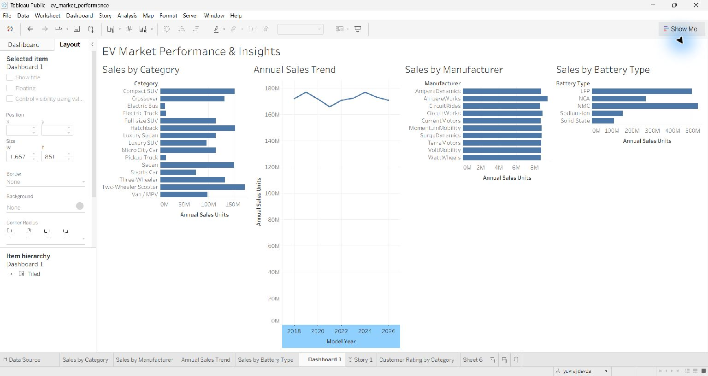
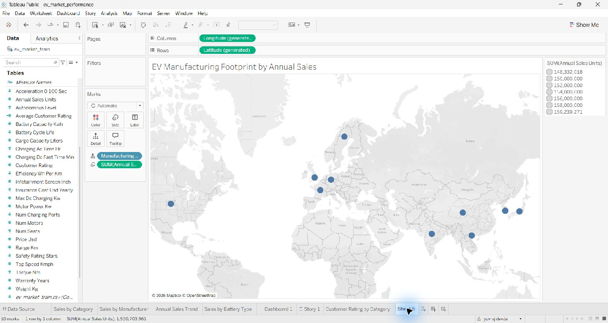

# Electric Vehicle Market Performance & Insights

A Tableau data analytics project exploring trends and segment differences in the supplied electric vehicle (EV) market dataset.

**Author:** Yuvraj Devda (`ZoroYuvraj`)  
**Contact:** [yuvrajdevdaji@gmail.com](mailto:yuvrajdevdaji@gmail.com)

> **Data note:** The CSV files were provided without source or licensing details. Treat results as patterns in this dataset, not independently verified facts about the global EV market.

## Contents

- [Project overview](#project-overview)
- [Workbook and deliverables](#workbook-and-deliverables)
- [Dataset](#dataset)
- [Methodology and interpretation](#methodology-and-interpretation)
- [Repository structure](#repository-structure)
- [Getting started](#getting-started)
- [Limitations and next steps](#limitations-and-next-steps)
- [Ownership and data rights](#ownership-and-data-rights)

## Project overview

This project uses Tableau to explore how EV category, manufacturer, model year, battery type, manufacturing country, and customer ratings vary in the supplied training data.

**Primary question:** What patterns in recorded annual sales units and vehicle specifications appear across the dataset's EV segments?

The analysis is descriptive. It does not establish causation, forecast demand, or verify the dataset's real-world accuracy.

## Workbook and deliverables

Open [`tableau/ev_market_performance.twbx`](tableau/ev_market_performance.twbx) in Tableau Public or Tableau Desktop. The packaged workbook includes the training CSV.

| Workbook item | Contents |
|---|---|
| Dashboard | Four views: sales by category, annual sales trend, top 10 manufacturers, and sales by battery type. Category selection can filter the dashboard views. |
| Worksheets | The four dashboard views, average customer rating by category, and a standalone EV manufacturing map. |
| Tableau Story | Six captioned scenes: overview, annual trend, category, manufacturers, battery mix, and customer ratings. |
| KPI graphic | Six-metric static summary at [`reports/kpi_cards.svg`](reports/kpi_cards.svg). It is not a live or filter-responsive Tableau view. |
| Project docs | [Project report](docs/PROJECT_REPORT.md), [Tableau build guide](docs/TABLEAU_BUILD_GUIDE.md), [data dictionary](docs/DATA_DICTIONARY.md), and [walkthrough script](docs/DEMO_SCRIPT.md). |

### Dashboard preview



### Manufacturing map

The map is a separate worksheet with 10 recognized country marks sized by the recorded annual sales measure; it is not embedded in the main dashboard or Story.



## Dataset

| File | Rows | Columns | Role |
|---|---:|---:|---|
| `data/raw/ev_market_train.csv` | 200,000 | 37 | Primary analysis source used by Tableau |
| `data/raw/ev_market_test.csv` | 100,000 | 37 | Separate validation/reference data |

The files share the same schema. Use the training file for primary dashboard totals and keep the test file separate unless a documented analysis requires otherwise.

## Methodology and interpretation

### Data scope

- The actual CSV files contain 37 columns each. If example screenshots or notes show 39 columns or different figures, use the supplied CSVs and recalculate the results.
- One `vehicle_id` repeats in the training file: 200,000 rows but 199,999 distinct IDs. Use distinct IDs when counting unique records.
- A row is a vehicle record/model observation. It should not automatically be interpreted as one vehicle registration.

### Measures

- `annual_sales_units` is analyzed as supplied. Its unit definition and reporting period are unverified; refer to it as the **recorded annual sales measure**, not confirmed units sold.
- Customer rating averages about 4.09 in the training file. Confirm its scale before describing it as a score out of 5.
- Keep train and test totals separate; do not combine the files for headline metrics without a documented reason.

### Illustrative training-file profile

These are descriptive summaries of the supplied training file, not verified market statistics:

- Average range: 324.54 km
- Average battery capacity: 78.24 kWh
- Average customer rating: 4.09 (scale unconfirmed)
- Sum of nonblank `annual_sales_units`: 1,550,703,961 (units and period unconfirmed)

More profiling details and missing-value counts are in [`reports/data_profile.json`](reports/data_profile.json) and [`reports/PERFORMANCE_NOTES.md`](reports/PERFORMANCE_NOTES.md).

## Repository structure

```text
data/raw/       Supplied training and test CSV files
docs/           Project report, data dictionary, Tableau guide, demo script
scripts/        Repeatable data profiling utility
tableau/        Editable (.twb) and packaged (.twbx) Tableau workbooks
reports/        KPI graphic, screenshots, profile output, QA notes
```

## Getting started

1. Install Tableau Public or Tableau Desktop.
2. Open [`tableau/ev_market_performance.twbx`](tableau/ev_market_performance.twbx).
3. Review the dashboard and open **EV Manufacturing Map** for the country-level view.
4. Read [`docs/PROJECT_REPORT.md`](docs/PROJECT_REPORT.md) for the findings and limitations.
5. To reproduce the CSV profile, run `python scripts/profile_data.py` with Python 3. The script uses only the standard library.
6. Use [`docs/DEMO_SCRIPT.md`](docs/DEMO_SCRIPT.md) to prepare the project walkthrough.

## Limitations and next steps

- The KPI cards are a static graphic. Build native Tableau KPI sheets if the rubric requires filter-responsive cards.
- The map is standalone; add it to a dashboard or Story only if the project requirements call for it.
- No timed rendering benchmark or multi-filter stress test has been recorded.
- The required 5–7 minute screen-share recording remains to be made; narration can be added afterward.
- Confirm the dataset's provenance, rating scale, sales measure definition, and redistribution rights with the mentor before presenting or publicly redistributing the data.

## Ownership and data rights

Original project documentation, scripts, and Tableau workbook are © 2026 Yuvraj Devda unless otherwise stated. No license granting reuse or redistribution is provided. The supplied dataset may have separate ownership and redistribution terms; confirm permission before republishing the CSVs or publishing the packaged workbook publicly.
